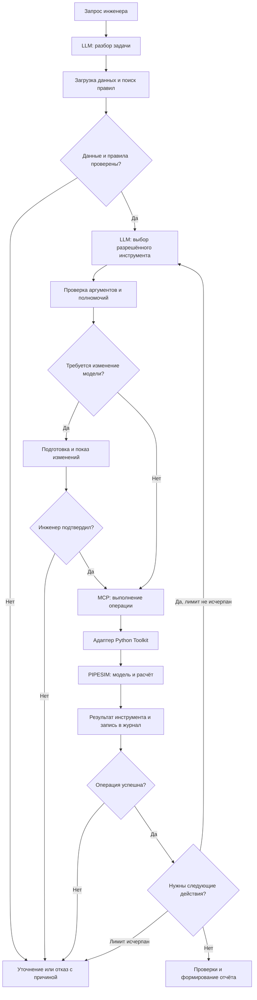

# Архитектура агента

Целевая архитектура проекта. На этапе 0 описаны компоненты
и порядок работы; интеграция с PIPESIM ещё не реализована.

## Схема выполнения

## Принципы работы

- LLM разбирает запрос, выбирает инструменты и объясняет результат.
- Физические расчёты выполняет PIPESIM.
- Единицы, ошибки, балансы и сравнения проверяет программный код.
- LangGraph хранит состояние запуска и управляет переходами.
- Поиск по документам возвращает правило и источник.
  Применимость и подтверждение правила проверяются отдельно.
- Планирование изменений не изменяет модель.
- Запись разрешается только после подтверждения конкретного
  плана изменений. Подтверждение проверяется программным кодом.
- Исходная модель сохраняется; изменения выполняются в копии.
- Каждый запуск имеет trace_id, связывающий запрос, вызовы
  инструментов, результаты и отчёт.
- Уточнения, отказы и остановки по лимиту также сохраняются
  в журнале. Уже полученные результаты не теряются.

  ## Компоненты системы

| Компонент | Ответственность |
|---|---|
| Точка входа agent.py | Принимает request и ctx, возвращает AgentResult |
| LLM | Разбирает запрос и выбирает разрешённые инструменты |
| LangGraph | Хранит состояние запуска, управляет переходами и лимитами |
| Схемы и валидация | Проверяют структуру данных, единицы, диапазоны и обязательные поля |
| RAG | Находит фрагменты методик с указанием документа, версии и раздела |
| MCP-клиент | Получает описания инструментов и вызывает разрешённые операции |
| MCP-сервер | Предоставляет инструменты, проверяет аргументы и разрешение на запись |
| Адаптер PIPESIM | Переводит операции инструментов в вызовы Python Toolkit |
| Проверки результатов | Проверяют перенос параметров, сходимость, баланс и соответствие допускам |
| Формирование отчёта | Собирает таблицы, графики, статусы и ссылки на источники |
| Журнал | Сохраняет обращения к LLM, вызовы инструментов, ответы и причины отказов |

Основной код размещается в Python-модулях репозитория.
Ноутбук используется для демонстрации, а не для хранения основной логики.

## Планируемые MCP-инструменты

Имена и границы инструментов приведены по ТЗ.
Конкретные вызовы Toolkit уточняются на установленной версии PIPESIM.

| Инструмент | Назначение | Изменение модели |
|---|---|---|
| read_manifest | Прочитать подтверждённые данные и ссылки на источники | Нет |
| validate_inputs | Проверить полноту, единицы, диапазоны и согласованность данных | Нет |
| prepare_model | Подготовить перечень объектов и план изменений | Нет |
| apply_approved_changes | Применить подтверждённый план к отдельной копии модели | Да, после подтверждения |
| read_model_parameters | Считать параметры сохранённой модели для сравнения с манифестом | Нет |
| run_steady_state | Запустить согласованный стационарный сценарий | Только расчётные результаты; изменение входов выполняется отдельно |
| read_results | Получить состояние расчёта, узловые значения и профили | Нет |

Каждый инструмент имеет имя, описание, схему аргументов,
явные единицы измерения и структурированный результат.

LLM не получает инструмент произвольного исполнения Python-кода
или команд операционной системы.

## Подтверждение изменений

1. Агент подготавливает план: какие объекты и параметры изменятся.
2. Инженер просматривает и подтверждает конкретный план.
3. Сервер проверяет подтверждение и соответствие версии модели.
4. Изменения применяются к копии модели.
5. Модель сохраняется, открывается повторно, параметры считываются
   и сравниваются с манифестом.

Изменение плана требует нового подтверждения.
Повтор уже выполненной операции не должен создавать дубликаты объектов.

## Сравнение двух сценариев

Базовый и дополнительный сценарии выполняются с согласованными
входными данными. Различия конфигураций сохраняются явно.

Давления, расходы и профили сравниваются кодом в одинаковых
единицах и контрольных точках.

Если один сценарий не выполнен, его значения не выдумываются.
Полученный результат другого сценария сохраняется,
а сравнение помечается как незавершённое.

## Статусы и обработка отказов

Состояние расчёта хранится отдельно от результата инженерной проверки.

- SUCCESS — расчёт выполнен.
- OK — проверяемая величина соответствует утверждённому допуску.
- OUT_OF_TOLERANCE — утверждённый допуск превышен.
- NOT_ASSESSED — проверка не выполнена, например отсутствует допуск.

Для пропусков, неверных единиц, недоступного ПО, занятой лицензии,
таймаута и отсутствия решения возвращаются отдельные причины отказа.

Повторы ограничиваются конфигурацией. При таймауте фиксируется
состояние расчётной задачи; отмена выполняется только через
поддерживаемый API.

## Прослеживаемость результата

Журнал связывает через trace_id:
- исходный запрос и выбранную задачу;
- обращения к LLM и предложенные ей инструменты;
- фактические аргументы MCP-инструментов;
- вызовы API PIPESIM, ответы и время выполнения;
- версию модели и конфигурацию сценария;
- подтверждения изменений;
- результаты проверок и причины отказов.

Числа в отчёте берутся из структурированных результатов инструментов
или вычисляются проверяемым кодом. API-ключи в журнал не записываются.
