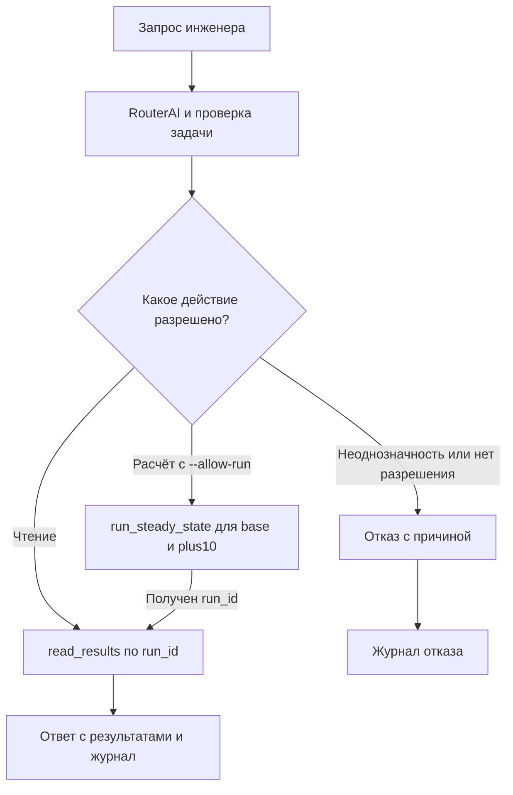

# Архитектура well-agent

Для участка АГЗУ-6 предусмотрены два входа. Команда `ask` принимает текстовый запрос и работает с зарегистрированным расчётом. Команда `prepare-model` собирает сеть по локальным исходным данным и запрашивает решение оператора. В обоих случаях клиент запускает MCP-сервер отдельным процессом на Windows и обменивается с ним сообщениями через стандартные потоки ввода и вывода (`stdio`). Расчётную работу выполняет установленный PIPESIM через Python Toolkit.

## Текстовый запрос и расчёт

1. `agent.py ask` передаёт запрос в `run(request, ctx)`. DeepSeek через RouterAI возвращает структурированную задачу. Код в `src/agent/loop.py` проверяет задачу и разрешение `--allow-run`. Для неоднозначного запроса возможен отказ до первого вызова MCP.
2. Для нового расчёта клиент передаёт инструменту `run_steady_state` идентификатор исходного запуска, `request_id` и набор сценариев. Сервер проверяет локальный профиль запуска и хеш подготовленной модели. Расчётный скрипт запускает PIPESIM на отдельной копии. Повтор того же запроса использует существующее задание.
3. Инструмент `read_results` по `run_id` находит отчёт в локальном реестре, проверяет контрольные суммы и возвращает запрошенный режим или сравнение. Модуль `src/agent/report.py` формирует текст из этих данных и сохраняет предупреждения. Если расчёт одного режима завершился с ошибкой, доступные результаты другого режима можно вернуть отдельно. Для сравнения нужны оба результата.

[Настройка текстового агента](agent_setup.md) · [Регистрация и запуск через MCP](mcp_run_setup.md)

## Подготовка сети и подтверждение записи

В команде `agent.py prepare-model` операцию выбирает инженер. Для этой сессии сервер дополнительно предоставляет два инструмента.

| Действие | Что видит оператор |
|---|---|
| `prepare_model` | План создания источника, линии и стока, связи, число точек профиля, параметры трубы, граничные условия и расходы. `plan_id` учитывает содержание плана и хеши входов. С флагом `--plan-only` работа завершается на этом шаге. |
| `apply_approved_changes` | Запрос подтверждения конкретного `plan_id`. При изменении входов требуется новый план. Пустой ответ завершает операцию со статусом `DECLINED`. |
| Сборка после подтверждения | Сборщик сохраняет снимок входов, создаёт копию модели с флюидом, вносит объекты и параметры, сохраняет и повторно открывает сеть. Успех означает `VERIFIED`. Проверенный повтор того же плана возвращает `ALREADY_BUILT` и путь к готовой копии. |

Сетевая модель `network.pips` и отчёт обратного чтения `network.json` сохраняются рядом. Раздел `after_reopen` показывает, какие связи, точки профиля и параметры прочитал PIPESIM. [Инструкция для оператора](mcp_model_preparation.md)

## От собранной сети до изотермического расчёта

На проверенном стенде `scripts/run_network_model.py` получил именно эту `network.pips` и снимок расходов из одобренного плана. Скрипт Toolkit создал изотермическую копию, задал 20 °C и `HEAT BALANCE=OFF`, сохранил и проверил настройки после открытия. Затем выполнил Run и Restart для каждого режима и сохранил первый отчёт.

Оператор зарегистрировал сетевую модель, расходы и первый отчёт командой `register`, а командой `configure-runner` привязал изотермическую копию к профилю запуска. После этого `run_steady_state` повторил расчёт через MCP. Совпадение хешей связывает первый отчёт с собранной сетью и повторный расчёт с изотермической копией. Переход от сборки к регистрации и настройке профиля выполняется отдельными командами.

## Как проследить результат

| Идентификатор | Что по нему проверить |
|---|---|
| `plan_id` | Какие изменения видел и одобрил оператор. В журнале решения сохранены план, признак `approved` и исход операции. |
| `request_id` | Какой запрос обрабатывал агент или расчётный инструмент. При повторе расчётного запроса сервер может вернуть уже зарегистрированный результат. |
| `run_id` | Из какого зарегистрированного запуска взяты давления, расходы и предупреждения. |
| `trace_id` | Какое действие отражено в конкретном журнале. У ответа агента и у каждого вызова MCP свои идентификаторы. Список `evidence` связывает ответ с вызовами инструментов. |

В закрытом комплекте сдачи файл `evidence/mcp_from_build/README.md` указывает на журналы плана, подтверждения, повтора и отказа, а также на отчёты двух расчётов. Для проверки происхождения числа можно взять входное давление `base`, найти его в результате `read_results` и сопоставить с отчётом PIPESIM по тому же `run_id`. Численная проверка и оценка по промысловым данным имеют отдельные статусы. Для выбранного участка промысловая оценка остаётся `NOT_ASSESSED`.

## Дорожная карта

Переход на LangGraph и поиск по методикам с указанием источников (RAG) остаются пунктами дорожной карты. В проверенной версии переходы между действиями задаёт Python-код, а состояние запросов и журналов хранится в локальном реестре.
